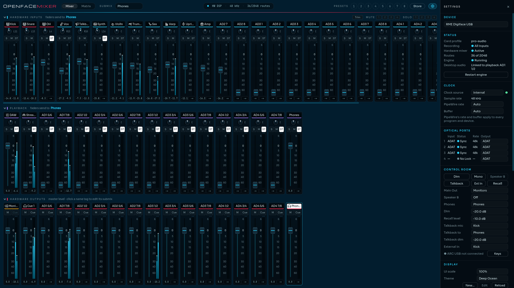
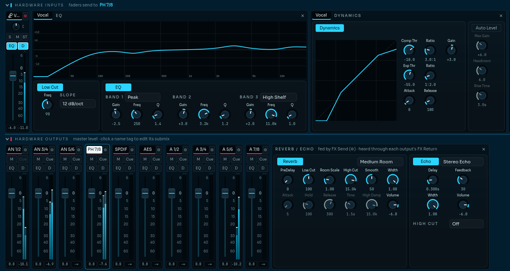
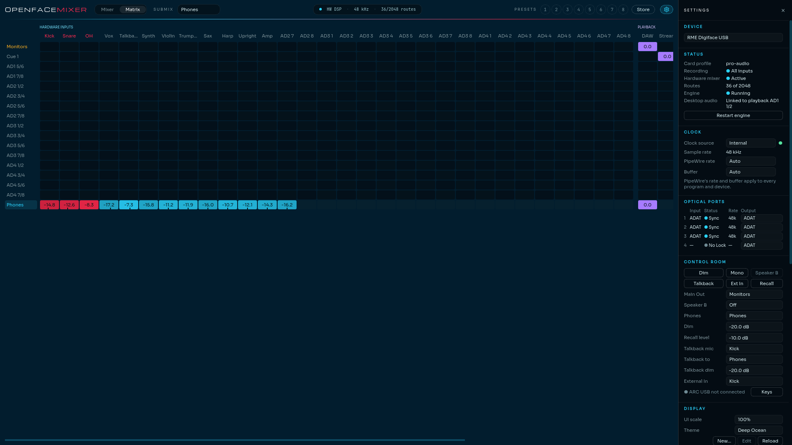

# Openface Mixer

A TotalMix-style mixer and control panel for the **RME Digiface USB**, the
**RME Fireface 802** (FireWire, or USB in Class Compliant mode), the **RME Fireface UCX II** (USB
in Class Compliant mode), the **RME Fireface 800 and 400** (FireWire) and the **RME HDSPe RayDAT,
AIO, AIO Pro and AES** (PCIe) on Linux. [Other TotalMix interfaces](#interfaces-not-supported-yet)
are not supported yet.



RME's TotalMix only runs on Windows and macOS. Linux streams audio to these interfaces
(`snd-usb-audio` for the Digiface since kernel 6.12 and the 802 and UCX II over USB,
`snd-fireface` for the 802, 800 and 400 over FireWire, `snd-hdspm` or `snd-hdspe` for the HDSPe
cards), but nothing gave them the TotalMix workflow. Openface Mixer drives the interface's own
DSP mixer, over USB or FireWire on the Firefaces and the Digiface and through the kernel driver
on the HDSPe cards, with the familiar TotalMix workflow.

- **Mixer view:** Hardware Inputs, Playback and Hardware Outputs, one row each.
  Pick an output, and the input and playback faders set the submix sent to it.
- **Matrix view:** route any input or playback channel to any output with a click.
- **Presets:** 8 snapshot slots, like TotalMix, plus export and import of mixes as files.
- **Workspaces:** *Save workspace* in the Mix section of the settings puts everything for one
  interface in one file, as TotalMix's workspaces do: the mix, names, colours, icons, layouts,
  presets, control room, device and effect settings, and the meter and ARC key options.
  *Load workspace* checks the whole file before it changes anything, keeps the mix it replaces
  for *Restore previous mix* and reopens the window. A workspace for another interface is
  refused. Solo, the network remote's settings and the desktop outputs and inputs are not part
  of a workspace.
- **UI scale:** the settings panel scales the whole window from 80% to 200%, on top of the
  desktop's display scale. The window is laid out larger or smaller (not rasterised and
  stretched), so it stays sharp at every scale, and the change applies right away.
- **Fader groups:** 4 groups that move together relatively. Hold Shift to move one fader alone.
- **Mute and solo groups like TotalMix:** 4 of each, switched with **MUTE 1–4** and **SOLO 1–4**
  at the end of the Hardware Inputs title. A mute group mutes its channels in the submix they
  were added in, so no other output is muted by mistake; a solo group solos its channels.
- **Submix tools like TotalMix:** right-click an output to copy its mix and paste it into
  another, or to mirror it (the other output then plays the same mix and follows every change).
  Right-click an input or playback channel to copy, paste or clear its sends to every output.
  **Trim** makes each fader move all of its channel's sends together, in every submix, and
  **Cue** on an output plays its mix on Main Out.
- **Channel strips:** compact, laid out like Pro Tools: name tag on top, pan with its value,
  solo, mute, stereo link, fader with its scale beside the peak meter, and level and peak
  readouts at the bottom. The Hardware Outputs row holds the output master faders.
- **Channel names, colours and icons like TotalMix:** right-click a strip → *Rename…* to give
  it your own name, *Color* to pick a colour for its name tag, and *Icon* for one of some fifty
  instrument, studio and device icons on the tag (all saved per device). *Custom channel
  names* in the Display section of the settings switches between your names and the standard
  ones.
- **Fold a row:** click the title of the Hardware Inputs, Playback or Hardware Outputs row to
  fold it to a slim strip of channel names over their meters; the other rows take the height.
  A folded row still shows which channels are soloed, muted or have clipped. Click the title
  again to unfold it. Which rows are folded is remembered per device.
- **Hide unused channels:** *Show* in the Display box hides whole channel groups (ADAT 1–4,
  AES, S/PDIF, Analog, Phones, as the interface has them) from the mixer and matrix. Hidden
  channels keep their routing; hiding one switches its solo off.
- **Layouts:** eight *Layouts* slots in the Display section store the view: hidden channel
  groups and strips, folded rows and *Custom channel names*. Click *Store*, then a slot, to save
  the view under a name; click a filled slot to bring it back. A layout never changes the mix
  (a strip it hides has its solo switched off). Layouts are saved per device.
- **Meters like TotalMix:** the bright bar is the RMS level and the dimmer bar above it the
  peak, on interfaces that report RMS (Digiface, 802 over USB, UCX II, and HDSPe inputs and
  playback; the FireWire Firefaces show peak only). In the Display section, *Show RMS level*
  switches the RMS bar off, *Peak hold* sets how long the peak line stays, and on the HDSPe
  cards *Clip after* sets how many full-scale samples in a row light the clip light. These are
  kept for this computer, for all devices.
- **Solo like TotalMix:** solo-in-place, post fader, in the current submix only.
- **Pan and stereo link like TotalMix:** a mono channel is 3 dB down on both sides at the
  centre. Linking two channels keeps what each had on its own, and unlinking brings it back.
- **Hardware panel:** clock source, ADAT or S/PDIF per optical port, and input lock/sync/rate status.
  On the Fireface 802 and UCX II also the AES/S/PDIF and optical options of TotalMix's settings
  dialog, on the Fireface 800 and 400 the line levels and the S/PDIF, optical and word clock
  options, on the HDSPe cards clock mode, preferred sync reference, internal rate, levels (AIO)
  and the S/PDIF, AES and word clock options.
- **Channel settings (Fireface 802):** the ⚙ on each hardware input and output strip, like
  TotalMix's wrench: phase invert on every channel, level and gain on inputs AN 1–8, 48V and
  Inst on inputs AN 9–12, and level on outputs AN 1–8.
- **Channel settings (Fireface UCX II):** phase invert on every channel, gain on AN 1–8, 48V on
  AN 1/2, level on AN 3–8, Hi-Z on AN 3/4, and level on outputs AN 1–6 and the phones.
- **TotalMix FX effects (Fireface 802 and UCX II):** the **EQ** and **D** buttons on every
  hardware input and output strip open TotalMix's EQ panel (Low Cut and a 3-band parametric EQ
  with its response curve) and Dynamics panel (compressor, expander and Auto Level); they light
  while an effect is on. A panel opens inside the row, right of its strip: the strips after it
  move right and the row scrolls, and several strips can have their panels open at once. A
  second click on the button closes it. **FX** in the top bar (Ctrl+E) opens Reverb and Echo at
  the end of the outputs row, fed by the **FX Send** in each input and playback channel's
  settings and heard through each output's **FX Return**. A muted channel, or one left out by a solo, sends nothing to the reverb and echo, and
  a stereo pair uses its left channel's effects on both sides. On the UCX II the outputs also have **Room EQ** (delay, volume calibration and 9
  bands, in a window of its own) and inputs AN 1–4 **Autoset**. Right-click a strip → *Copy effects* / *Paste effects*
  to reuse settings.

  
- **Input options (Fireface 800):** the ⚙ on inputs AN 1 and AN 7–10: front or rear jack on
  AN 1, 7 and 8, 48V on AN 7–10, and Drive, Limiter and Speaker Emulation on the AN 1
  instrument input.
- **Input options (Fireface 400):** 48V and gain on AN 1/2, instrument, pad and gain on AN 3/4.
- **Desktop outputs and inputs:** right-click a playback strip → *Add desktop output…* for a
  stereo sink on that pair ("Openface Music" on playback 3/4), or an input strip → *Add desktop
  input…* for a mono or stereo source a chat app can record from. Rename or remove them from the
  same menu.
- **PipeWire's sample rate and buffer** at the end of the Clock box: Auto, or a rate from 44.1
  to 192 kHz and a buffer from 32 to 2048 frames.
- **Several interfaces:** pick the device in the settings panel. Each has its own mix, presets
  and engine, so a Digiface and a Fireface can run side by side.
- **Always on:** the mix keeps running with the window closed. A small engine service restores
  it at login.

> **How mixing works:** Openface Mixer drives the interface's own DSP mixer (over USB on the
> Digiface, over FireWire or USB MIDI on the Firefaces, through `snd-hdspm` or `snd-hdspe` on the HDSPe cards), like TotalMix, so input monitoring has no added latency and the mix keeps running in the
> interface even with the computer idle. There is no software mixing. See
> [docs/ARCHITECTURE.md](docs/ARCHITECTURE.md) and [docs/HARDWARE.md](docs/HARDWARE.md).

### Matrix view



## Requirements

- Linux 6.12 or newer (Digiface USB support in `snd-usb-audio`), or for the Fireface 802, 800
  or 400 a FireWire port and the `snd-fireface` driver (in the kernel since 5.x), or for the 802
  or UCX II over USB the interface in Class Compliant mode (`snd-usb-audio`, any recent kernel),
  or for the HDSPe cards the `snd-hdspm` driver (in the kernel; cards before 2022) or the
  `snd-hdspe` driver (cards from 2022 on, see below)
- The Digiface USB on its standard firmware, **not** Class Compliant mode. Its Class Compliant
  firmware has no hardware mixer (no TotalMix), so there is nothing for Openface Mixer to
  control; switch back with RME's Firmware Update Tool (Windows or macOS)
- PipeWire with WirePlumber, for the desktop outputs and inputs and the PipeWire rate and buffer
  settings. The hardware mixer works without it (under JACK alone, for example)
- Python 3.10+ with PySide6
- libusb 1.0 and udev rules for the Digiface and FireWire access (installed by `make install`)
- Build tools: a C compiler, `pkg-config`, and the libpipewire development headers
- `amixer` (alsa-utils) and `pactl` (libpulse)

On Arch / CachyOS:

```sh
sudo pacman -S --needed pyside6 qt6-svg libpipewire libusb alsa-utils libpulse gcc pkgconf make
```

On Debian 13 / Ubuntu 25.04 or newer:

```sh
sudo apt install python3-pyside6.qtwidgets python3-pyside6.qtnetwork python3-pyside6.qtsvg libpipewire-0.3-dev libusb-1.0-0-dev alsa-utils pulseaudio-utils build-essential pkg-config
```

Ubuntu 24.04 and Debian 12 have no PySide6 packages. There, leave the three `python3-pyside6`
packages out and install PySide6 for your user with pip:
`pip install --user --break-system-packages PySide6-Essentials`.

## Install

```sh
git clone https://github.com/thomas-nelson23/Openface-Mixer.git
cd Openface-Mixer
make install
```

This installs to `~/.local` (or `make install PREFIX=/somewhere/else`), adds **Openface Mixer**
to your app menu and installs the engine's user services. An interface's engine is switched on
for every login the first time Openface Mixer sees that interface, so there is no engine or
playback sink for hardware you don't have.

Remove it with `make uninstall` (with the same `PREFIX=` if you gave one). That also removes
the *Start at login* entries. The udev rules belong to root, so it prints the one command that
removes them. Mixes and presets stay.

On Arch, [packaging/aur](packaging/aur) has a recipe for a system package
(`openface-mixer-git`). A packaged copy is updated by the package manager, not by the
**Updates** section.

### Updates

**Updates** in the settings panel shows which version is installed. A few seconds after the
app starts it looks on GitHub for a newer one, without a word unless there is one: then the
gear button gets a dot and the section lists what is new. Untick *Check when the app starts*
to look only when you press **Check for updates**.

*Update to* chooses what you get:

- **Releases** (the default): versions that have been tried, tagged `vX.Y.Z` on `main`. A
  copy that is already past the newest release stays as it is until the next one. Until the
  first release is tagged, this follows `main`.
- **Latest changes**: every change as soon as it is merged into `main`. For testers.

**Update and restart** backs up `~/.config/openface-mixer` (the newest three backups are
kept), fast-forwards the checkout you installed from, reinstalls and restarts. Keep that
checkout where it is and on `main`; if it has local changes or commits of its own, update by
hand with `git pull && make install`.

What changed in each version is in [CHANGELOG.md](CHANGELOG.md), with a list of fixes that
still need a tester with the hardware.

## First run

1. Open **Openface Mixer**. It opens the interface that is connected; to pick another, use
   **Device** at the top of the settings, where the connected interfaces say so.
2. Monitoring works in any PipeWire profile, because the mix happens in the interface. To
   *record* all 32 inputs in apps, switch the Digiface to the **Pro Audio** profile: click
   *Record all inputs* in the settings panel (Digiface only), or pick the profile in your sound
   settings.
3. To send desktop audio through the mixer, select **Openface Mixer Playback** as your output
   device. It feeds playback channels 1/2. For more, right-click a playback strip → *Add desktop
   output…*: the sink you name ("Music" shows as **Openface Music**) feeds that pair, so
   each app can have its own fader. *Add desktop input…* on an input strip makes a source apps
   can record from. Status → *Desktop audio* says whether they are linked; its tooltip lists
   them. One on a channel the interface lacks at the current sample rate is left out and comes
   back at a rate that has it. A DAW can still use the interface's own channels (playback
   channel *n* = output *n*) through qpwgraph or Helvum.
4. Click an output's name tag (bottom row) to select its submix, then raise input and playback
   faders. Alternatively, click cells in the **Matrix** view.

### Sample rate and buffer

*PipeWire rate* and *Buffer* in the Clock box set PipeWire's `clock.force-rate` and
`clock.force-quantum` (with `pw-metadata`), so they apply to every program and every device, not
only this interface. **Auto** lets PipeWire choose and writes nothing. A forced value lasts
until PipeWire restarts; Openface Mixer does not set it again at login, because it is not the
app's alone (two devices' windows, or another tool, could disagree) and the app may not be
running. For a permanent choice, set `default.clock.rate` and `default.clock.quantum` in a file
under `~/.config/pipewire/pipewire.conf.d/`.

The interface follows the rate PipeWire plays at. On an HDSPe card, *Internal rate* is the
rate the card runs at while nothing plays (and its master rate when *Clock mode* is Master); as
soon as PipeWire opens the card it sets the card to the PipeWire rate. On the FireWire
Firefaces the rate comes from the driver the same way, and *Clock source* only says where the
clock comes from. With an external clock (word clock, ADAT, AES), choose the rate that clock
runs at.

### Controls

| Action | How |
| --- | --- |
| Fine fader move | Ctrl + drag (or Ctrl + scroll) |
| Fader from the keyboard | Click a fader (or Tab to it), then Up/Down (1 dB, Ctrl = 0.5 dB), Page Up/Down (6 dB), Home (0 dB), End (-∞) |
| Fader to 0 dB | Double-click or Alt-click |
| Type a fader level | Double-click the level under the fader (or press Enter on the fader), type `-12`, `+3` or `off`, then Enter. Esc cancels |
| Centre pan | Double-click the knob (or Home); Left/Right move it |
| Reset peak / clip | Click the meter |
| Solo | **S** on a strip: solo-in-place in the current submix |
| Store a preset | Click an empty slot. To overwrite one, click **Store**, then the slot (Esc cancels), or right-click it. In a narrow window: **Presets ▾** |
| Export / import a mix | Settings → Mix |
| Save or load everything for this interface | Settings → Mix → *Save workspace…* / *Load workspace…* |
| Store or recall a layout | Settings → Display → *Layouts*: **Store**, then a slot (Esc cancels); click a filled slot to recall it |
| Recall a preset | Click a lit slot |
| Take back a recall, import, reset, paste or clear | Right-click a slot → *Restore previous mix* (in a narrow window: **Presets ▾**). It brings back the mix as it was just before |
| Fader groups | Right-click a strip → *Fader group*. Hold Shift to move one fader alone. |
| Mute and solo groups | Right-click a strip → *Mute group in …* (for the submix being edited) or *Solo group*, then switch the group with **MUTE 1–4** or **SOLO 1–4** |
| Copy a submix | Right-click an output → *Copy mix*, then right-click another → *Paste mix from …* or *Mirror mix of …*. *Remove mirror* gives the output its own copy again |
| Copy or clear a channel's sends | Right-click an input or playback strip → *Copy sends*, *Paste sends from …* or *Clear sends…* |
| Trim | **Trim** at the end of the Hardware Inputs title: a fader moves all of its channel's sends by the same amount, in every submix. Sends that are off stay off |
| Cue | **Cue** on an output strip: hear that output's mix on Main Out. Press it again, or another output's, to end it |
| Desktop output or input | Right-click a playback strip → *Add desktop output…*, or an input strip → *Add desktop input…*. The same menu renames or removes it |
| Rename a channel | Double-click its name, or right-click the strip → *Rename…* (empty = standard name). Settings → Display → *Custom channel names* toggles custom / standard names |
| Fold a row | Click the row's title (or Tab to it and press Space or Enter). Click again to unfold. In a folded row of inputs or playback channels, a click on a name unfolds it too |
| Hide channels | Right-click a strip → *Hide channel*, or Settings → Display → *Show*: untick a channel group. Right-click empty mixer space to bring hidden ones back |
| Matrix | Click an empty cell for 0 dB, drag up or down to set its level, double-click or Delete to clear it. Scrolling moves the grid; Ctrl + scroll changes a level. Arrow keys move the selection, Enter types a level |
| Mixer / Matrix view | Ctrl+1 / Ctrl+2 |
| Effects (802, UCX II) | **EQ** / **D** on a strip open its panel in the row, and close it again; **FX** or Ctrl+E for Reverb and Echo. Knobs: drag or scroll (Shift = fine), double-click for the default, right-click or Enter to type a value. Esc or Ctrl+W closes a panel |
| Show or hide settings | Ctrl+, (or the gear). The window reopens at its last size, with the settings open or closed as you left them |

### Keyboard shortcuts

The same list is in the app: **Keyboard shortcuts** at the bottom of the settings, then
**Show**. The effects are on the Fireface 802 and UCX II.

| Where | Keys | What they do |
| --- | --- | --- |
| Window | Ctrl+, | Show or hide settings |
| Window | Ctrl+1, Ctrl+2 | Mixer, Matrix |
| Window | Tab, Shift+Tab | Next, previous control |
| Window | Esc | Cancel Store or typing |
| Window | Ctrl+Q | Quit |
| Row title | Space, Enter | Fold or unfold the row |
| Fader | Up, Down | 1 dB (Ctrl: 0.5 dB) |
| Fader | Page Up / Down | 6 dB |
| Fader | Home | 0 dB |
| Fader | End | Off (-∞) |
| Fader | Enter | Type a level |
| Pan knob | Left, Right | Pan |
| Pan knob | Home | Centre |
| Matrix | Arrow keys | Move the selection |
| Matrix | Enter | Type a level |
| Matrix | Delete | Clear the cell |
| Effects | Ctrl+E | Reverb and Echo |
| Effects | Esc, Ctrl+W | Close a panel |
| Effects knob | Arrow keys | Turn (Shift: fine) |
| Effects knob | Page Up / Down | Ten steps |
| Effects knob | Home | Default value |
| Effects knob | Enter | Type a value |

### Desktop shortcuts

A running mixer takes commands, so the desktop's own keyboard shortcut settings can give it
global hotkeys. On KDE Plasma: *System Settings → Keyboard → Shortcuts → Add New → Command or
Script*. On GNOME: *Settings → Keyboard → View and Customize Shortcuts → Custom Shortcuts*.

| Command | What it does |
| --- | --- |
| `openface-mixer --dim` | Dim on or off |
| `openface-mixer --mute-main` | Main Out mute on or off |
| `openface-mixer --recall 3` | Recall preset 3 (1 to 8) |
| `openface-mixer --show` | Show the window, starting the mixer if needed |

With two interfaces, add `--device <key>` (for example `--device ff802`). If that mixer is not
running, a command other than `--show` does nothing, so a hotkey never opens a window by
surprise: it prints why and exits with status 1.

### Control room and ARC USB

The **Control Room** box in the settings panel has TotalMix's monitoring switches. They act on
the output pair set as **Main Out** and are not part of presets:

| Switch | What it does |
| --- | --- |
| Dim | Lowers Main Out by the amount set under *Dim* (20 dB to start with) |
| Recall | Sets Main Out to the level set under *Recall level* |
| Mono | Sums Main Out to mono |
| Speaker B | Sends the Main Out mix to the Speaker B pair instead, at the Main Out level. Pick the pair under *Speaker B* first; it stays silent while Speaker B is off |
| Talkback | Sends the talkback mic input to the Phones, with the rest of their mix turned down by the amount set under *Talkback dim* |
| Ext In | Replaces the Main Out mix with the External In input pair |
| Cue | **Cue** on an output strip plays that output's mix on Main Out, at the Main Out level, until it is pressed again or another output is cued. Dim, Speaker B and Talkback still work. Not saved |

*Phones* takes up to four headphone outputs. Talkback always goes to all of them; tick further
outputs under *Talkback to* if others should hear it too.

Plug in an **RME ARC USB** (into the computer, not the Digiface) and it works with the default
TotalMix layout printed on it:

- Rows 1 and 2: recall presets 1 to 8.
- Row 3: Mono, Volume Phones 1 and 2, External Input.
- Bottom: Talkback (tap to latch, hold to talk), Speaker B, Dim.
- Encoder: Main Out volume in 0.5 dB steps, or the volume of the first or second Phones output
  (in the order they were ticked) while its key is lit. With one Phones output both keys
  select it and both light up. Faders grouped with it follow, as with the mouse.

Key LEDs follow the state. **Keys** beside the ARC's status in the Control Room box lists the
keys: each can do any of these functions instead, and *Reset to default* brings back the printed
layout. The choice is kept for this computer, not with the mix. The ARC needs no driver or
setup; Openface Mixer must be running for it to work (its window can be hidden, see below).

### Network remote (OSC)

Openface Mixer can be controlled over the network by anything that speaks TotalMix FX's
**Global OSC** (TotalMix FX 2.1 and later): a Q-SYS or Crestron plugin, Bitfocus Companion, a
Stream Deck, TouchOSC. Tick **Allow OSC control** in the **Network remote** section of the settings sidebar and
point the controller at this computer's IP address and the UDP port shown there (7001, the
TotalMix default). Replies go back to the address and port each controller sends from; a
controller that listens on a port of its own (TouchOSC, or anything set up for TotalMix's "Port
outgoing") also gets everything at the **Send to** host and **Port out** (9001, the TotalMix
default).

What a controller can do, with TotalMix's addresses and zero-based channel numbers:

| Address | What it does |
| --- | --- |
| `/mix/in/<ch>/<out>/faderlin`, `fader` | Send from an input to an output pair (0..1 TotalMix fader position, or dB) |
| `/mix/pb/<ch>/<out>/faderlin`, `fader` | The same for a playback channel |
| `/mix/in/<ch>/<out>/solo`, `/mix/pb/…/solo` | Solo, and select that output pair's submix |
| `/input/<ch>/mute`, `/playback/<ch>/mute` | Channel mute |
| `/input/<ch>/stereo`, `/playback/<ch>/stereo` | Link or unlink a pair |
| `/output/<ch>/faderlin`, `volume`, `mute` | Output pair level and mute |
| `/controlroom/dim`, `mainmono`, `speakerb`, `talkback`, `externalin` | Control Room switches |
| `/globalsolo` | Switch all solos off (0) |
| `/snapshot/load/<1-8>`, `/snapshot/save/<1-8>` | Recall or store a preset |
| `/sendall`, `/sendstate`, `/sendsubmix/<out>`, `/sendchan/<bus>/<ch>` | Ask for the current state |

Openface Mixer sends names, link state, faders, mutes, solos, the Control Room switches, the lit
preset and (unless switched off) peak levels in dB to `/level/in|pb|out/<ch>`, whenever they
change. Writing to either channel of a linked pair changes both. Phase, EQ, dynamics and
TotalMix's global mute have no equivalent and are ignored.

Anyone who can reach the port can change the mix while the remote is on, so only turn it on in
a network you trust. To keep the mixer, the ARC USB and the remote running without a window,
tick **Start at login, no window**, or run `openface-mixer --background --device <key>`. Opening
Openface Mixer again for that device shows the window, and closing it only hides it; **Ctrl+Q**
quits. It stays that way after an update restart, a new UI scale or a switch to another device.
Each device has its own window and login entry, so two interfaces can run side by side.

A mixer started this way has an icon in the system tray: click it to show or hide the window,
right-click it for Dim, Mute main out, the presets and Quit. The icon gets a cyan dot while Dim
or the main out mute is on, and is greyed with a red dot while the engine is stopped or the
interface can't be used. **Tray icon**, below Start at login, can show it **Always** (closing the
window then only hides it, for any mixer) or **Never**. On a desktop without a tray (GNOME without
an extension) nothing changes.

### Fireface 802

Connect the 802 over **FireWire** or **USB**. Openface Mixer opens the connected interface, or
pick it under **Device** in the settings panel: **RME Fireface 802** is the FireWire connection
(`openface-mixer --device ff802`), **RME Fireface 802 (USB)** the USB one
(`openface-mixer --device ff802usb`). The first time the GUI finds the 802, it enables the device's
engine (`openface-mixer-engine@ff802` or `@ff802usb`), which then restores the 802's mix at every
login. Its playback sink is called **Openface Mixer Playback (Fireface 802)** or **(Fireface 802
USB)**. The two connections keep separate mixes.

Over USB, Linux runs the 802 only in **Class Compliant mode** (switch it on at the 802, see its
manual). There the mixer is controlled through the 802's second USB MIDI port, the way RME's
TotalMix FX for iPad does it, so the 802's MIDI ports must not be held open exclusively by another
program (sharing them through PipeWire's MIDI bridge is fine). Class Compliant mode streams 22
playback channels (AN 1–8, PH 9–12, AES, ADAT 1–8); all 30 hardware inputs and outputs are in the
mix.

Openface Mixer is the source of truth for the 802's DSP, as TotalMix is: when it connects it
sends the whole mix and all settings, including the effects (low cut, EQ, dynamics, auto level,
FX sends and returns, reverb and echo; all off until you switch them on). Over FireWire the
clock source and the options are the exception: Openface Mixer shows the clock the 802 runs
from and does not touch them until you change one of them. Don't run
`snd-fireface-ctl-service` alongside it.

### Fireface UCX II

The UCX II works like the 802 over USB: switch it to **Class Compliant mode** (see its manual),
connect it over USB and pick **RME Fireface UCX II** under **Device** (or run
`openface-mixer --device ucx2`); its engine is `openface-mixer-engine@ucx2`. All 20 inputs (AN 1–8,
S/PDIF, AES, ADAT), 20 playback channels and 20 outputs (AN 1–6, phones PH 7/8, S/PDIF, AES,
ADAT) are in the mix. Openface Mixer sets the UCX II's *CC Mix* option to TotalMix so its DSP
mixer is what you hear, and, as on the 802, sends the effects as set in Openface Mixer (channel
effects, room EQ, reverb and echo; all off until you switch them on). The MIDI port rule of the 802 applies, and don't run oscmix alongside it.

### Fireface 800

The 800 works the same way: connect it over **FireWire**, pick **RME Fireface 800** under
**Device** (or run `openface-mixer --device ff800`), and its engine
(`openface-mixer-engine@ff800`) restores the mix at every login. Its playback sink is called
**Openface Mixer Playback (Fireface 800)**. All 28 inputs (AN 1–10, S/PDIF, ADAT 1 and 2), 28
playback channels and 28 outputs (AN 1–8, phones PH 9/10, S/PDIF, ADAT 1 and 2) are in the mix.

The 800's settings can't be read back, except the clock source and the S/PDIF and optical
options. Openface Mixer shows those as the 800 reports them and changes nothing on the unit
until you change a setting. That first change sends all of them: the clock the 800 reported,
and for the rest (line levels, input jacks, 48V, instrument options) what the panel shows,
which starts at Lo Gain in, Hi Gain out, front jacks and 48V off. From then on Openface Mixer
sends its own copy on every connect, as TotalMix does. Don't run `snd-fireface-ctl-service`
alongside it either.

The **Fireface 400** (`openface-mixer --device ff400`, engine `openface-mixer-engine@ff400`)
works exactly like the 800 and needs the same udev rule. All 18 inputs (AN 1–8, S/PDIF, ADAT),
18 playback channels and 18 outputs (AN 1–6, phones PH 7/8, S/PDIF, ADAT) are in the mix. Its
input gains are set from the ⚙ on AN 1–4 (the front knobs' last settings can't be read back, so
they start at 0 dB). The output faders also drive the 400's analog output amplifiers, as
snd-firewire-ctl-services does.

### HDSPe RayDAT, AIO, AIO Pro and AES

Pick the card under **Device** (or run `openface-mixer --device raydat`, `aio`, `aiopro` or
`aes`), and its engine (`openface-mixer-engine@raydat` and so on) restores the mix at every
login. Everything below about the RayDAT applies to all four; their channels are:

- **RayDAT:** 36 channels, see below.
- **AIO and AIO Pro:** analog AN 1/2, phones PH L/R (outputs), AES, S/PDIF and ADAT (8, 4 or 2
  channels by speed). The optional AI4S/AO4S extension boards (analog 3–6) aren't in the mix
  yet. The playback sink feeds AN 1/2.
- **AES:** AES 1–16 at every speed. The playback sink feeds AES 1/2.

On the RayDAT, pick **RME HDSPe RayDAT** under **Device** (or run `openface-mixer --device raydat`), and its engine
(`openface-mixer-engine@raydat`) restores the mix at every login. All 36 inputs, 36 playback
channels and 36 outputs are in the mix, in the card's own order as in TotalMix: AES, S/PDIF,
then ADAT 1–4 (`A1 1` … `A4 8`; 20 channels at 88.2/96 kHz, 12 at 176.4/192 kHz). Both drivers
start with the mixer silent, so nothing plays until Openface Mixer (or another mixer) has set
it up.

Which driver the card needs depends on its age:

- Cards from before 2022 run on the kernel's own `snd-hdspm`; nothing to install.
- Cards from 2022 on need [snd-hdspe](https://github.com/Schroedingers-Cat/snd-hdspe) (its
  `develop` branch). The kernel's `snd-hdspm` still claims them but doesn't run them properly,
  so Openface Mixer leaves such a card alone and says so. Which cards those are is a guess (see
  [Status and limitations](#status-and-limitations)): if yours works with `snd-hdspm`, choose **Use
  anyway** in the settings panel. Otherwise install snd-hdspe with DKMS as its README
  describes (`make install`) and blacklist the old driver:

      echo "blacklist snd-hdspm" | sudo tee /etc/modprobe.d/hdspe.conf

  snd-hdspe works on older cards too. With it, the settings panel also offers the S/PDIF input,
  optical S/PDIF out, the internal ADAT boards (AEB/TEB) and track marker options that its
  configuration tool, hdspeconf, has.

The **Openface Mixer Playback (RayDAT)** sink feeds the driver's first two playback channels,
which are ADAT 1 channels 1/2 (`A1 1/2`), not AES. The card has no output faders of its own, so
the output masters are folded into every send, as TotalMix does on this card. A send and its
output's level can add up to +6 dB at most; a fader held there shows its level in red. The clock and
S/PDIF settings are the driver's ALSA controls, which Openface Mixer reads and writes live; they
aren't stored with the mix. Don't run `hdspmixer` alongside it: the last one to write wins.
With two cards of the same model, the settings panel lets you pick which one to mix.

## Files

| Path | Contents |
| --- | --- |
| `~/.config/openface-mixer/state.json` | Current mix and UI state (Digiface) |
| `~/.config/openface-mixer/state.json.bak` | The save before the current one, loaded if `state.json` can't be read (Digiface) |
| `~/.config/openface-mixer/presets.json` | The 8 preset slots (Digiface) |
| `~/.config/openface-mixer/presets.json.bak` | Only after a `presets.json` that could not be read in full: that file as it was, kept when the presets are next saved (Digiface) |
| `~/.config/openface-mixer/previous-mix.json` | The mix as it was before the last recall, import, reset or workspace load, for *Restore previous mix* (Digiface) |
| `~/.config/openface-mixer/matrix.bin` | Flattened gain matrix that the engine loads at startup (Digiface) |
| `~/.config/openface-mixer/sinks.conf` | The desktop outputs and inputs, written by the app for the engine (Digiface) |
| `~/.config/openface-mixer/ff802/` | The same files for the Fireface 802 (its clock, AES and channel settings are saved in its `state.json` and `matrix.bin`) |
| `~/.config/openface-mixer/ff802usb/` | The same for the Fireface 802 over USB |
| `~/.config/openface-mixer/ff800/` | The same for the Fireface 800 |
| `~/.config/openface-mixer/ucx2/`, `ff400/` | The same for the Fireface UCX II and 400 |
| `~/.config/openface-mixer/raydat/`, `aio/`, `aiopro/`, `aes/` | The same for the HDSPe cards |
| `~/.config/openface-mixer/device` | The device the GUI opened last |
| `~/.config/openface-mixer/ui.json` | Window (UI) scale and size, the Updates choices, the meter options, the ARC USB keys and the Tray icon setting, shared by all devices |
| `~/.config/autostart/openface-mixer-<device>.desktop` | Starts that device's Openface Mixer at login without a window (when ticked), one file per device |
| `~/.cache/openface-mixer/engine-<device>.log` | Engine log (only when started without systemd) |

## Development

```sh
make          # build the engine
make test     # unit tests (no hardware or display needed)
make lint     # byte-compile and pyflakes
make run      # run the GUI from the source tree
make help     # list all targets
```

Read [CONTRIBUTING.md](CONTRIBUTING.md) and [docs/ARCHITECTURE.md](docs/ARCHITECTURE.md) first.
Hardware notes are in [docs/HARDWARE.md](docs/HARDWARE.md).

## Status and limitations

- The Digiface USB is only tested at 48 kHz (single speed). The UI is designed to adapt to
  2x/4x channel counts, but that path is untested.
- Fireface 802 support follows the protocol documented by snd-firewire-ctl-services and has
  not been checked on a unit yet (see [docs/HARDWARE.md](docs/HARDWARE.md#not-verified-on-hardware-yet)).
  The TotalMix FX effects (on the 802 and the UCX II) follow the same sources and haven't been
  heard on a unit yet either; see [docs/HARDWARE.md](docs/HARDWARE.md#totalmix-fx-effects).
  They are not part of presets, and the dynamics and auto level gain-reduction meters aren't
  shown. Over USB the 802 follows the Class Compliant protocol documented by oscmix,
  also not yet checked with Openface Mixer on a unit. The ARC USB's two phones keys select PH 9/10 and
  PH 11/12 once both are ticked under *Phones* in the Control Room box (PH 9/10 alone by default).
- Fireface 800 support also comes from snd-firewire-ctl-services and the kernel driver and has
  not been checked on a unit yet (see [docs/HARDWARE.md](docs/HARDWARE.md#fireface-800-not-verified-on-hardware-yet)).
- Fireface UCX II support follows oscmix's register documentation, Fireface 400 support
  snd-firewire-ctl-services; neither has been checked on a unit yet.
- HDSPe RayDAT, AIO, AIO Pro and AES support is built on the kernel's `snd-hdspm` driver, the
  `snd-hdspe` driver, hdspeconf and alsa-tools' hdspmixer, and has not been checked on a card yet
  (see [docs/HARDWARE.md](docs/HARDWARE.md#raydat-not-verified-on-hardware-yet)).
  The driver only accepts mixer changes while playback and recording are opened by the same
  program (PipeWire or JACK normally do that). No TCO or pitch settings. A card counts as
  2022-or-later (snd-hdspe only) when its PCI vendor ID is RME's own, `1d18`; that rule is not
  confirmed, so it only warns. With the kernel driver an AIO Pro shows up as an AIO, and on an
  AIO at 88.2 kHz and above the ADAT channels may not line up with their strips
  ([docs/HARDWARE.md](docs/HARDWARE.md#aio-aio-pro-and-aes)).
- The Digiface's hardware mixer allows 2048 active routes; the settings panel warns if a mix
  needs more.
- The mixer needs USB access to the Digiface and FireWire access to the Firefaces (the udev rules
  `make install` installs, which need sudo once). Without them nothing is mixed, and the
  settings panel says why.
- Meters come from the interface itself: inputs, playback and the hardware outputs (post mix).
- Solo has no PFL / live mode or exclusive mode yet.
- No EQ, dynamics or reverb on the Digiface: its DSP has no effects.
- The network remote is checked against TotalMix FX's published OSC addresses and a Q-SYS
  plugin, not against TotalMix itself; controllers that only speak TotalMix's older bank-based OSC
  (before version 2.1) are not supported.
- ARC USB: the footswitch is not supported (it sent nothing in testing).

### Interfaces not supported yet

These TotalMix interfaces are left out for now:

| Interface | Why |
| --- | --- |
| HDSPe MADI, MADI FX, MADIface USB/XT/Pro, Fireface UFX+, UFX III | More than 36 channels per direction, the mix model's limit (and no Linux mixer driver for the MADI FX) |
| Fireface UFX II, 802 FS | Their Class Compliant mixer protocol isn't documented beyond partial notes |
| Fireface UFX, UCX (original) | Their DSP protocols aren't documented for Linux (the UCX's FireWire mic channels, the UFX's DSP) |
| Babyface Pro FS | The kernel exposes its mixer but no meters; a candidate for later |
| Babyface, Babyface Pro, Fireface UC | No Linux access to their mixers |
| HDSP 9632/9652, Multiface, Digiface (PCI), RPM | The older `snd-hdsp` driver: firmware loading and a different mixer; the RPM has no mixer |
| Digiface Dante, AVB and Ravenna interfaces | Network audio with no Linux control path |

## Acknowledgements

- **Asahi Lina** wrote the Digiface USB support in the Linux kernel and
  [rmectl](https://github.com/hoshinolina/rmectl). The USB protocol for the hardware mixer comes
  from those two; the level-meter format was decoded for this project
  (see [docs/HARDWARE.md](docs/HARDWARE.md)).
- **Takashi Sakamoto** wrote the kernel's `snd-fireface` driver and
  [snd-firewire-ctl-services](https://github.com/alsa-project/snd-firewire-ctl-services), whose
  Fireface 802, 800 and 400 protocol code is where their register and DSP layouts come
  from.
- [oscmix](https://github.com/michaelforney/oscmix) by Michael Forney does the same job for the
  Fireface UCX II and was the model for controlling the interface's own mixer instead of mixing
  in software. Its documentation of the Class Compliant SysEx protocol and of the Fireface 802's
  registers (on its wiki, with contributions from its users) is what the 802's and UCX II's
  USB support is built on. None of its code is used here, and it does not support the Digiface.

## License

MIT. See [LICENSE](LICENSE). The bundled fonts (Sora, JetBrains Mono, Michroma, in
`openface_mixer/fonts/`) are under the SIL Open Font License; see the OFL files next to them. Not affiliated with RME (Audio AG). "TotalMix", "Digiface" and
"Fireface" are trademarks of their respective owners.
