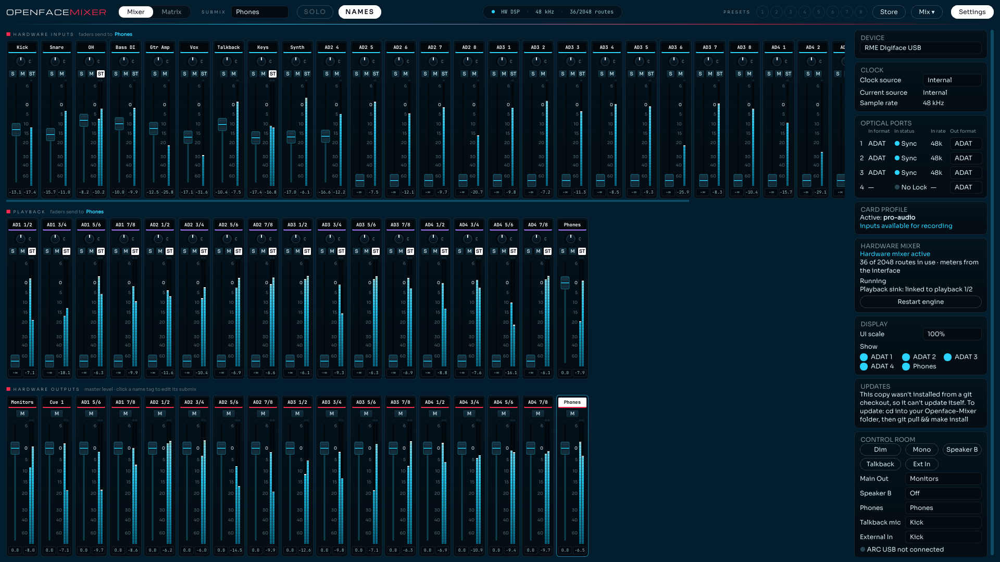
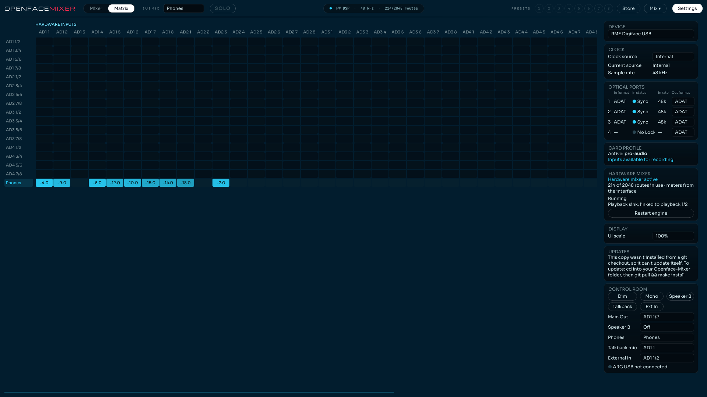

# Openface Mixer

A TotalMix-style mixer and control panel for the **RME Digiface USB**, the
**RME Fireface 802** (FireWire, or USB in Class Compliant mode), the **RME Fireface UCX II** (USB
in Class Compliant mode), the **RME Fireface 800 and 400** (FireWire) and the **RME HDSPe RayDAT,
AIO, AIO Pro and AES** (PCIe) on Linux. [Other TotalMix interfaces](#interfaces-not-supported-yet)
are not supported yet.



RME's TotalMix only runs on Windows and macOS. Linux streams audio to these interfaces
(`snd-usb-audio` for the Digiface since kernel 6.12 and the 802 and UCX II over USB,
`snd-fireface` for the 802, 800 and 400 over FireWire, `snd-hdspm` or `snd-hdspe` for the HDSPe
cards), but nothing gave them the TotalMix workflow. Openface Mixer drives the interface's own
DSP mixer, over USB or FireWire on the Firefaces and the Digiface and through the kernel driver
on the HDSPe cards, with the familiar TotalMix workflow.

- **Mixer view:** Hardware Inputs, Playback and Hardware Outputs, one row each.
  Pick an output, and the input and playback faders set the submix sent to it.
- **Matrix view:** route any input or playback channel to any output with a click.
- **Presets:** 8 snapshot slots, like TotalMix, plus export and import of mixes as files.
- **UI scale:** the settings panel scales the whole window from 80% to 200%, on top of the
  desktop's display scale. The window is laid out larger or smaller (not rasterised and
  stretched), so it stays sharp at every scale, and the change applies right away.
- **Fader groups:** 4 groups that move together relatively. Hold Shift to move one fader alone.
- **Channel strips:** compact, laid out like Pro Tools: name tag on top, pan with its value,
  solo, mute, stereo link, fader with its scale beside the peak meter, and level and peak
  readouts at the bottom. The Hardware Outputs row holds the output master faders.
- **Channel names, colours and icons like TotalMix:** right-click a strip → *Rename…* to give
  it your own name, *Color* to pick a colour for its name tag, and *Icon* for one of some fifty
  instrument, studio and device icons on the tag (all saved per device). *Custom channel
  names* in the Display section of the settings switches between your names and the standard
  ones.
- **Hide unused channels:** *Show* in the Display box hides whole channel groups (ADAT 1–4,
  AES, S/PDIF, Analog, Phones, as the interface has them) from the mixer and matrix. Hidden
  channels keep their routing.
- **Solo like TotalMix:** solo-in-place, post fader, in the current submix only.
- **Hardware panel:** clock source, ADAT or S/PDIF per optical port, and input lock/sync/rate status.
  On the Fireface 802 and UCX II also the AES/S/PDIF and optical options of TotalMix's settings
  dialog, on the Fireface 800 and 400 the line levels and the S/PDIF, optical and word clock
  options, on the HDSPe cards clock mode, preferred sync reference, internal rate, levels (AIO)
  and the S/PDIF, AES and word clock options.
- **Channel settings (Fireface 802):** the ⚙ on each hardware input and output strip, like
  TotalMix's wrench: phase invert on every channel, level and gain on inputs AN 1–8, 48V and
  Inst on inputs AN 9–12, and level on outputs AN 1–8.
- **Channel settings (Fireface UCX II):** phase invert on every channel, gain on AN 1–8, 48V on
  AN 1/2, level on AN 3–8, Hi-Z on AN 3/4, and level on outputs AN 1–6 and the phones.
- **Input options (Fireface 800):** the ⚙ on inputs AN 1 and AN 7–10: front or rear jack on
  AN 1, 7 and 8, 48V on AN 7–10, and Drive, Limiter and Speaker Emulation on the AN 1
  instrument input.
- **Input options (Fireface 400):** 48V and gain on AN 1/2, instrument, pad and gain on AN 3/4.
- **Several interfaces:** pick the device in the settings panel. Each has its own mix, presets
  and engine, so a Digiface and a Fireface can run side by side.
- **Always on:** the mix keeps running with the window closed. A small engine service restores
  it at login.

> **How mixing works:** Openface Mixer drives the interface's own DSP mixer (over USB on the
> Digiface, over FireWire or USB MIDI on the Firefaces, through `snd-hdspm` or `snd-hdspe` on the HDSPe cards), like TotalMix, so input monitoring has no added latency and the mix keeps running in the
> interface even with the computer idle. There is no software mixing. See
> [docs/ARCHITECTURE.md](docs/ARCHITECTURE.md) and [docs/HARDWARE.md](docs/HARDWARE.md).

### Matrix view



## Requirements

- Linux 6.12 or newer (Digiface USB support in `snd-usb-audio`), or for the Fireface 802, 800
  or 400 a FireWire port and the `snd-fireface` driver (in the kernel since 5.x), or for the 802
  or UCX II over USB the interface in Class Compliant mode (`snd-usb-audio`, any recent kernel),
  or for the HDSPe cards the `snd-hdspm` driver (in the kernel; cards before 2022) or the
  `snd-hdspe` driver (cards from 2022 on, see below)
- PipeWire with WirePlumber
- Python 3.10+ with PySide6
- libusb 1.0 and udev rules for the Digiface and FireWire access (installed by `make install`)
- Build tools: a C compiler, `pkg-config`, and the libpipewire development headers
- `amixer` (alsa-utils) and `pactl` (libpulse)

On Arch / CachyOS:

```sh
sudo pacman -S --needed pyside6 libpipewire libusb alsa-utils libpulse gcc pkgconf make
```

On Debian / Ubuntu:

```sh
sudo apt install python3-pyside6.qtwidgets python3-pyside6.qtsvg libpipewire-0.3-dev libusb-1.0-0-dev alsa-utils pulseaudio-utils build-essential pkg-config
```

## Install

```sh
git clone https://github.com/thomas-nelson23/Openface-Mixer.git
cd Openface-Mixer
make install
```

This installs to `~/.local`, adds **Openface Mixer** to your app menu, and enables the
`openface-mixer-engine` user service. Remove it with `make uninstall`.

To update later, use **Updates** in the settings panel: it checks GitHub for new commits on
`main` and, on **Update and restart**, backs up `~/.config/openface-mixer`, pulls the checkout
you installed from, reinstalls and restarts. Keep that checkout where it is; if it has local
changes or isn't on `main`, update by hand with `git pull && make install`.

## First run

1. Open **Openface Mixer**.
2. Monitoring works in any PipeWire profile, because the mix happens in the interface. To
   *record* all 32 inputs in apps, switch the Digiface to the **Pro Audio** profile: click
   *Record all inputs* in the settings panel (Digiface only), or pick the profile in your sound
   settings.
3. To send desktop audio through the mixer, select **Openface Mixer Playback** as your output
   device. It feeds playback channels 1/2. Send other apps or a DAW to the interface's own output
   channels (playback channel *n* = output *n*) with qpwgraph or Helvum.
4. Click an output's name tag (bottom row) to select its submix, then raise input and playback
   faders. Alternatively, click cells in the **Matrix** view.

### Controls

| Action | How |
| --- | --- |
| Fine fader move | Ctrl + drag (or Ctrl + scroll) |
| Fader from the keyboard | Click a fader (or Tab to it), then Up/Down (1 dB, Ctrl = 0.5 dB), Page Up/Down (6 dB), Home (0 dB), End (-∞) |
| Fader to 0 dB | Double-click or Alt-click |
| Centre pan | Double-click the knob (or Home); Left/Right move it |
| Reset peak / clip | Click the meter |
| Solo | **S** on a strip: solo-in-place in the current submix |
| Store a preset | Click an empty slot. To overwrite one, click **Store**, then the slot (Esc cancels), or right-click it. In a narrow window: **Presets ▾** |
| Export / import a mix | Settings → Mix |
| Recall a preset | Click a lit slot |
| Fader groups | Right-click a strip → *Fader group*. Hold Shift to move one fader alone. |
| Rename a channel | Double-click its name, or right-click the strip → *Rename…* (empty = standard name). Settings → Display → *Custom channel names* toggles custom / standard names |
| Hide channels | Right-click a strip → *Hide channel*, or Settings → Display → *Show*: untick a channel group. Right-click empty mixer space to bring hidden ones back |
| Matrix | Click a cell to toggle 0 dB / off, scroll to adjust, right-click to clear |
| Mixer / Matrix view | Ctrl+1 / Ctrl+2 |
| Show or hide settings | Ctrl+, (or the gear). The window reopens at its last size, with the settings open or closed as you left them |

### Control room and ARC USB

The **Control Room** box in the settings panel has TotalMix's monitoring switches. They act on
the output pair set as **Main Out** and are not part of presets:

| Switch | What it does |
| --- | --- |
| Dim | Lowers Main Out by 20 dB |
| Mono | Sums Main Out to mono |
| Speaker B | Sends the Main Out mix to the Speaker B pair instead, at the Main Out level. Pick the pair under *Speaker B* first; it stays silent while Speaker B is off |
| Talkback | Sends the talkback mic input to Phones, with the rest of the phones mix 20 dB down |
| Ext In | Replaces the Main Out mix with the External In input pair |

Plug in an **RME ARC USB** (into the computer, not the Digiface) and it works with the default
TotalMix layout printed on it:

- Rows 1 and 2: recall presets 1 to 8.
- Row 3: Mono, Phones (both phones keys), External Input.
- Bottom: Talkback (tap to latch, hold to talk), Speaker B, Dim.
- Encoder: Main Out volume in 0.5 dB steps, or Phones volume while a Phones key is lit. Faders
  grouped with it follow, as with the mouse.

Key LEDs follow the state. The ARC needs no driver or setup; Openface Mixer must be running for
it to work (its window can be hidden, see below).

### Network remote (OSC)

Openface Mixer can be controlled over the network by anything that speaks TotalMix FX's
**Global OSC** (TotalMix FX 2.1 and later): a Q-SYS or Crestron plugin, Bitfocus Companion, a
Stream Deck, TouchOSC. Tick **Allow OSC control** in the **Network remote** section of the settings sidebar and
point the controller at this computer's IP address and the UDP port shown there (7001, the
TotalMix default). Replies go back to the address and port each controller sends from.

What a controller can do, with TotalMix's addresses and zero-based channel numbers:

| Address | What it does |
| --- | --- |
| `/mix/in/<ch>/<out>/faderlin`, `fader` | Send from an input to an output pair (0..1 TotalMix fader position, or dB) |
| `/mix/pb/<ch>/<out>/faderlin`, `fader` | The same for a playback channel |
| `/mix/in/<ch>/<out>/solo`, `/mix/pb/…/solo` | Solo, and select that output pair's submix |
| `/input/<ch>/mute`, `/playback/<ch>/mute` | Channel mute |
| `/input/<ch>/stereo`, `/playback/<ch>/stereo` | Link or unlink a pair |
| `/output/<ch>/faderlin`, `volume`, `mute` | Output pair level and mute |
| `/controlroom/dim`, `mainmono`, `speakerb`, `talkback`, `externalin` | Control Room switches |
| `/globalsolo` | Switch all solos off (0) |
| `/snapshot/load/<1-8>`, `/snapshot/save/<1-8>` | Recall or store a preset |
| `/sendall`, `/sendstate`, `/sendsubmix/<out>`, `/sendchan/<bus>/<ch>` | Ask for the current state |

Openface Mixer sends names, link state, faders, mutes, solos, the Control Room switches, the lit
preset and (unless switched off) peak levels in dB to `/level/in|pb|out/<ch>`, whenever they
change. Writing to either channel of a linked pair changes both. Phase, EQ, dynamics and
TotalMix's global mute have no equivalent and are ignored.

Anyone who can reach the port can change the mix while the remote is on, so only turn it on in
a network you trust. To keep the mixer, the ARC USB and the remote running without a window,
tick **Start at login, no window**, or run `openface-mixer --background`. Opening Openface
Mixer again shows the window, and closing it only hides it; **Ctrl+Q** quits.

### Fireface 802

Connect the 802 over **FireWire** or **USB**. Openface Mixer opens the connected interface, or
pick it under **Device** in the settings panel: **RME Fireface 802** is the FireWire connection
(`openface-mixer --device ff802`), **RME Fireface 802 (USB)** the USB one
(`openface-mixer --device ff802usb`). The first time, the GUI starts and enables the device's
engine (`openface-mixer-engine@ff802` or `@ff802usb`), which then restores the 802's mix at every
login. Its playback sink is called **Openface Mixer Playback (Fireface 802)** or **(Fireface 802
USB)**. The two connections keep separate mixes.

Over USB, Linux runs the 802 only in **Class Compliant mode** (switch it on at the 802, see its
manual). There the mixer is controlled through the 802's second USB MIDI port, the way RME's
TotalMix FX for iPad does it, so the 802's MIDI ports must not be held open exclusively by another
program (sharing them through PipeWire's MIDI bridge is fine). Class Compliant mode streams 22
playback channels (AN 1–8, PH 9–12, AES, ADAT 1–8); all 30 hardware inputs and outputs are in the
mix.

Openface Mixer is the source of truth for the 802's DSP, as TotalMix is: when it connects it
sends the whole mix and all settings, and it switches the DSP's EQ, dynamics, low cut, auto level
and reverb/echo off, because it has no controls for them yet. Don't run
`snd-fireface-ctl-service` alongside it.

### Fireface UCX II

The UCX II works like the 802 over USB: switch it to **Class Compliant mode** (see its manual),
connect it over USB and pick **RME Fireface UCX II** under **Device** (or run
`openface-mixer --device ucx2`); its engine is `openface-mixer-engine@ucx2`. All 20 inputs (AN 1–8,
S/PDIF, AES, ADAT), 20 playback channels and 20 outputs (AN 1–6, phones PH 7/8, S/PDIF, AES,
ADAT) are in the mix. Openface Mixer sets the UCX II's *CC Mix* option to TotalMix so its DSP
mixer is what you hear, and, as on the 802, switches the channel effects, room EQ and
reverb/echo off. The MIDI port rule of the 802 applies, and don't run oscmix alongside it.

### Fireface 800

The 800 works the same way: connect it over **FireWire**, pick **RME Fireface 800** under
**Device** (or run `openface-mixer --device ff800`), and its engine
(`openface-mixer-engine@ff800`) restores the mix at every login. Its playback sink is called
**Openface Mixer Playback (Fireface 800)**. All 28 inputs (AN 1–10, S/PDIF, ADAT 1 and 2), 28
playback channels and 28 outputs (AN 1–8, phones PH 9/10, S/PDIF, ADAT 1 and 2) are in the mix.

The 800's settings can't be read back, except the clock source and the S/PDIF and optical
options. So the first time it connects, Openface Mixer takes those from the device, starts the
rest (line levels, input jacks, 48V, instrument options) at their defaults (Lo Gain in, Hi Gain
out, front jacks, 48V off), and from then on sends its own copy, as TotalMix does. Don't run
`snd-fireface-ctl-service` alongside it either.

The **Fireface 400** (`openface-mixer --device ff400`, engine `openface-mixer-engine@ff400`)
works exactly like the 800 and needs the same udev rule. All 18 inputs (AN 1–8, S/PDIF, ADAT),
18 playback channels and 18 outputs (AN 1–6, phones PH 7/8, S/PDIF, ADAT) are in the mix. Its
input gains are set from the ⚙ on AN 1–4 (the front knobs' last settings can't be read back, so
they start at 0 dB). The output faders also drive the 400's analog output amplifiers, as
snd-firewire-ctl-services does.

### HDSPe RayDAT, AIO, AIO Pro and AES

Pick the card under **Device** (or run `openface-mixer --device raydat`, `aio`, `aiopro` or
`aes`), and its engine (`openface-mixer-engine@raydat` and so on) restores the mix at every
login. Everything below about the RayDAT applies to all four; their channels are:

- **RayDAT:** 36 channels, see below.
- **AIO and AIO Pro:** analog AN 1/2, phones PH L/R (outputs), AES, S/PDIF and ADAT (8, 4 or 2
  channels by speed). The optional AI4S/AO4S extension boards (analog 3–6) aren't in the mix
  yet. The playback sink feeds AN 1/2.
- **AES:** AES 1–16 at every speed. The playback sink feeds AES 1/2.

On the RayDAT, pick **RME HDSPe RayDAT** under **Device** (or run `openface-mixer --device raydat`), and its engine
(`openface-mixer-engine@raydat`) restores the mix at every login. All 36 inputs, 36 playback
channels and 36 outputs are in the mix, in the card's own order as in TotalMix: AES, S/PDIF,
then ADAT 1–4 (`A1 1` … `A4 8`; 20 channels at 88.2/96 kHz, 12 at 176.4/192 kHz). The driver
starts with the mixer silent, so nothing plays until Openface Mixer (or another mixer) has set
it up.

Which driver the card needs depends on its age:

- Cards from before 2022 run on the kernel's own `snd-hdspm`; nothing to install.
- Cards from 2022 on need [snd-hdspe](https://github.com/Schroedingers-Cat/snd-hdspe) (its
  `develop` branch). The kernel's `snd-hdspm` still claims them but can't run them, so Openface
  Mixer leaves such a card alone and says so. Install snd-hdspe with DKMS as its README
  describes (`make install`) and blacklist the old driver:

      echo "blacklist snd-hdspm" | sudo tee /etc/modprobe.d/hdspe.conf

  snd-hdspe works on older cards too. With it, the settings panel also offers the S/PDIF input,
  optical S/PDIF out, the internal ADAT boards (AEB/TEB) and track marker options that its
  configuration tool, hdspeconf, has.

The **Openface Mixer Playback (RayDAT)** sink feeds the driver's first two playback channels,
which are ADAT 1 channels 1/2 (`A1 1/2`), not AES. The card has no output faders of its own, so
the output masters are folded into every send, as TotalMix does on this card. The clock and
S/PDIF settings are the driver's ALSA controls, which Openface Mixer reads and writes live; they
aren't stored with the mix. Don't run `hdspmixer` alongside it: the last one to write wins.

## Files

| Path | Contents |
| --- | --- |
| `~/.config/openface-mixer/state.json` | Current mix and UI state (Digiface) |
| `~/.config/openface-mixer/presets.json` | The 8 preset slots (Digiface) |
| `~/.config/openface-mixer/matrix.bin` | Flattened gain matrix that the engine loads at startup (Digiface) |
| `~/.config/openface-mixer/ff802/` | The same three files for the Fireface 802 (its clock, AES and channel settings are saved in its `state.json` and `matrix.bin`) |
| `~/.config/openface-mixer/ff802usb/` | The same for the Fireface 802 over USB |
| `~/.config/openface-mixer/ff800/` | The same for the Fireface 800 |
| `~/.config/openface-mixer/ucx2/`, `ff400/` | The same for the Fireface UCX II and 400 |
| `~/.config/openface-mixer/raydat/`, `aio/`, `aiopro/`, `aes/` | The same for the HDSPe cards |
| `~/.config/openface-mixer/device` | The device the GUI opened last |
| `~/.config/openface-mixer/ui.json` | Window (UI) scale, shared by all devices |
| `~/.config/autostart/openface-mixer.desktop` | Starts Openface Mixer at login without a window (when ticked) |
| `~/.cache/openface-mixer/engine-<device>.log` | Engine log (only when started without systemd) |

## Development

```sh
make          # build the engine
make test     # unit tests (no hardware or display needed)
make run      # run the GUI from the source tree
make help     # list all targets
```

Read [CONTRIBUTING.md](CONTRIBUTING.md) and [docs/ARCHITECTURE.md](docs/ARCHITECTURE.md) first.
Hardware notes are in [docs/HARDWARE.md](docs/HARDWARE.md).

## Status and limitations

- The Digiface USB is only tested at 48 kHz (single speed). The UI is designed to adapt to
  2x/4x channel counts, but that path is untested.
- Fireface 802 support follows the protocol documented by snd-firewire-ctl-services and has
  not been checked on a unit yet (see [docs/HARDWARE.md](docs/HARDWARE.md#not-verified-on-hardware-yet)).
  It has no EQ, dynamics, auto level or reverb/echo controls yet; those DSP effects are
  switched off. Over USB the 802 follows the Class Compliant protocol documented by oscmix,
  also not yet checked with Openface Mixer on a unit. The ARC USB's two phones keys both select the one Phones pair set in the
  Control Room box (PH 9/10 by default), not PH 9/10 and PH 11/12 separately.
- Fireface 800 support also comes from snd-firewire-ctl-services and the kernel driver and has
  not been checked on a unit yet (see [docs/HARDWARE.md](docs/HARDWARE.md#fireface-800-not-verified-on-hardware-yet)).
  The TCO module isn't offered as a clock source.
- Fireface UCX II support follows oscmix's register documentation, Fireface 400 support
  snd-firewire-ctl-services; neither has been checked on a unit yet.
- HDSPe RayDAT, AIO, AIO Pro and AES support is built on the kernel's `snd-hdspm` driver, the
  `snd-hdspe` driver, hdspeconf and alsa-tools' hdspmixer, and has not been checked on a card yet
  (see [docs/HARDWARE.md](docs/HARDWARE.md#raydat-not-verified-on-hardware-yet)).
  The driver only accepts mixer changes while playback and recording are opened by the same
  program (PipeWire or JACK normally do that). No TCO or pitch settings. A card counts as
  2022-or-later (snd-hdspe only) when its PCI vendor ID is RME's own, `1d18`.
- The Digiface's hardware mixer allows 2048 active routes; the settings panel warns if a mix
  needs more.

### Interfaces not supported yet

These TotalMix interfaces are left out for now:

| Interface | Why |
| --- | --- |
| HDSPe MADI, MADI FX, MADIface USB/XT/Pro, Fireface UFX+, UFX III | More than 36 channels per direction, the mix model's limit (and no Linux mixer driver for the MADI FX) |
| Fireface UFX II, 802 FS | Their Class Compliant mixer protocol isn't documented beyond partial notes |
| Fireface UFX, UCX (original) | Their DSP protocols aren't documented for Linux (the UCX's FireWire mic channels, the UFX's DSP) |
| Babyface Pro FS | The kernel exposes its mixer but no meters; a candidate for later |
| Babyface, Babyface Pro, Fireface UC | No Linux access to their mixers |
| HDSP 9632/9652, Multiface, Digiface (PCI), RPM | The older `snd-hdsp` driver: firmware loading and a different mixer; the RPM has no mixer |
| Digiface Dante, AVB and Ravenna interfaces | Network audio with no Linux control path |
- The mixer needs USB access to the Digiface and FireWire access to the Firefaces (the udev rules
  `make install` installs, which need sudo once). Without them nothing is mixed, and the
  settings panel says why.
- Meters come from the interface itself: inputs, playback and the hardware outputs (post mix).
- Solo has no PFL / live mode or exclusive mode yet.
- No EQ, dynamics or reverb on the Digiface: its DSP has no effects.
- The network remote is checked against TotalMix FX's published OSC addresses and a Q-SYS
  plugin, not against TotalMix itself; controllers that only speak TotalMix's older bank-based OSC
  (before version 2.1) are not supported.
- ARC USB: key assignments are fixed to TotalMix's default layout, and the footswitch is not
  supported (it sent nothing in testing).

## Acknowledgements

- **Asahi Lina** wrote the Digiface USB support in the Linux kernel and
  [rmectl](https://github.com/hoshinolina/rmectl). The USB protocol for the hardware mixer comes
  from those two; the level-meter format was decoded for this project
  (see [docs/HARDWARE.md](docs/HARDWARE.md)).
- **Takashi Sakamoto** wrote the kernel's `snd-fireface` driver and
  [snd-firewire-ctl-services](https://github.com/alsa-project/snd-firewire-ctl-services), whose
  Fireface 802, 800 and 400 protocol code is where their register and DSP layouts come
  from.
- [oscmix](https://github.com/michaelforney/oscmix) by Michael Forney does the same job for the
  Fireface UCX II and was the model for controlling the interface's own mixer instead of mixing
  in software. Its documentation of the Class Compliant SysEx protocol and of the Fireface 802's
  registers (on its wiki, with contributions from its users) is what the 802's and UCX II's
  USB support is built on. None of its code is used here, and it does not support the Digiface.

## License

MIT. See [LICENSE](LICENSE). The bundled fonts (Sora, JetBrains Mono, Michroma, in
`openface_mixer/fonts/`) are under the SIL Open Font License; see the OFL files next to them. Not affiliated with RME (Audio AG). "TotalMix", "Digiface" and
"Fireface" are trademarks of their respective owners.
